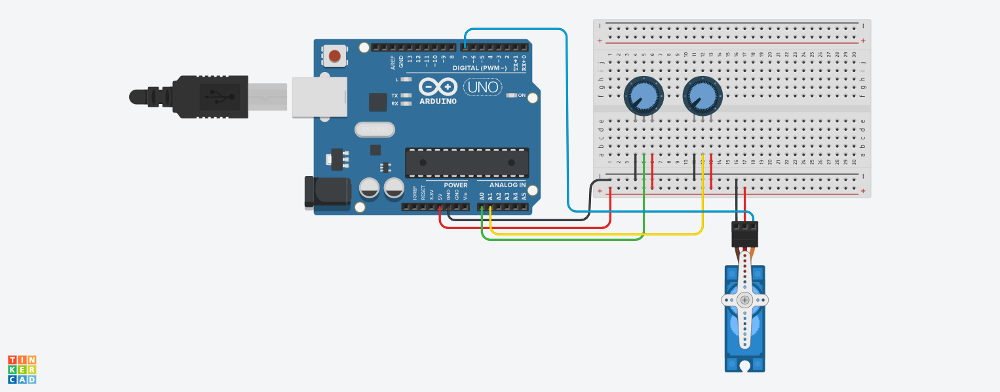

# Projeto-01---Controle-de-Servo-Motor-com-Potenci-metros
Este projeto utiliza um servo motor controlado por dois potenciômetros conectados ao Arduino. O primeiro potenciômetro ajusta o ângulo máximo de rotação do servo, enquanto o segundo controla a velocidade do movimento. O sistema permite alterar ambos os parâmetros em tempo real, tornando o controle mais preciso e interativo.

## Curso
Análise e Desenvolvimento de Sistemas

## Unidade Curricular
Sistema Embarcados

## Aluno(s)
- Nickolas Lamin

## Descrição do Projeto

Este projeto utiliza um servo motor e dois potenciômetros para realizar controles distintos:

- Potenciômetro 1: controla o ângulo máximo de giro do servo motor.
- Potenciômetro 2: controla a velocidade de movimentação do servo motor.

O sistema realiza a leitura dos valores analógicos dos potenciômetros através do Arduino e ajusta dinamicamente o comportamento do servo motor.

## Componentes Utilizados

- Arduino Uno
- Servo Motor SG90
- 2 Potenciômetros
- Protoboard
- Jumpers

## Funcionamento

O primeiro potenciômetro define o limite máximo de rotação do servo entre 0° e 180°.

O segundo potenciômetro controla o tempo de deslocamento do servo, alterando a velocidade de movimento.

Dessa forma, é possível variar tanto a amplitude quanto a velocidade do giro em tempo real.

## Diagrama do Projeto

## Projeto em Funcionamento

